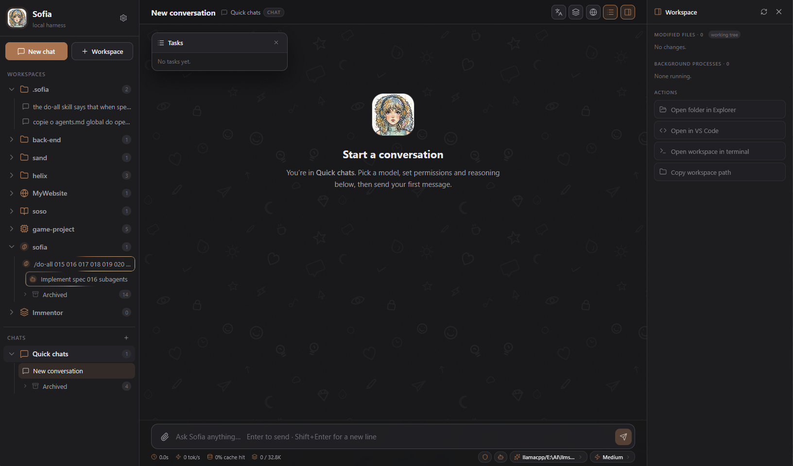

# Sofia

<p align="center">
  
</p>
<p align="center">
  
  
  
  
  
</p>
<p align="center">
  <br/>
  Made in Brazil.
</p>

Sofia is a local AI harness—an ASP.NET Core agent server and a Vue web interface, built from scratch (following [pi.dev](https://pi.dev)). It provides a comprehensive environment for AI development, featuring workspaces, parallel subagents, MCP support, change tracking, and local model discovery (Ollama, Unsloth, etc.).

<p align="center">
  
</p>

## How it fits together

```
Sofia.UI (Vue 3.5 + Vite + TypeScript) ──REST + SignalR
├─ Sofia.Server (ASP.NET, .NET 10)
├─ SQLite (~/.sofia/sofia.sqlite)
├─ local runtimes: Unsloth, Ollama, LM Studio, llama.cpp, vLLM
├─ cloud: OpenAI-compatible and Anthropic APIs
└─ MCP servers (stdio and HTTP)
```

Local model runtimes are discovered automatically, together with each model's
context window.

## Download and run

Grab the zip for your OS from the
[latest release](https://github.com/icavalheiro/sofia/releases/latest). Builds
are self-contained: no .NET install needed.

| OS | Asset |
| --- | --- |
| Windows (x64) | `sofia-<version>-win-x64.zip` |
| Linux (x64) | `sofia-<version>-linux-x64.zip` |
| macOS Apple Silicon | `sofia-<version>-osx-arm64.zip` |
| macOS Intel | `sofia-<version>-osx-x64.zip` |

Verify (optional): download `SHA256SUMS` next to the zips and run
`sha256sum -c SHA256SUMS --ignore-missing` (macOS: `shasum -a 256 -c SHA256SUMS --ignore-missing`).

```powershell
# Windows
Expand-Archive sofia-<version>-win-x64.zip .
.\sofia-<version>-win-x64\Sofia.Server.exe
```

```bash
# Linux / macOS
unzip sofia-<version>-<rid>.zip
./sofia-<version>-<rid>/Sofia.Server
```

Then open http://127.0.0.1:5199. No pairing code is needed on the same machine.
Data lives in `~/.sofia`.

Environment variables the server reads:

- `SOFIA_HOME` — data folder (default `~/.sofia`).
- `SOFIA_URLS` — listen address; set it to expose the server (remote clients must pair).
- `SOFIA_LOCAL_ENDPOINTS` — extra local model runtimes to discover.
- Provider keys: `OPENAI_API_KEY`, `ANTHROPIC_API_KEY`, `OPENROUTER_API_KEY`,
  `GEMINI_API_KEY`, `DEEPSEEK_API_KEY`, `GROQ_API_KEY`, `MISTRAL_API_KEY`,
  `XAI_API_KEY`, `OPENCODE_API_KEY`, `QWENCLOUD_API_KEY` (or set keys in Settings).

Optional dependencies: `git`, `ripgrep` and an installed browser are not required;
without them the related features degrade. The `browser` tool drives a browser
**already installed on the machine running the server** — Google Chrome, Microsoft
Edge, Brave, Vivaldi, Opera, Chromium or Firefox, looked up in the platform's
standard install locations and on `PATH` (override one with
`SOFIA_BROWSER_CHROME=/path/to/chrome`). It opens a **real window** on that
machine's desktop, with a dedicated Sofia profile under
`<SOFIA_HOME>/browsers/`, so the user can log in and keep using it; the agent
drives the same window. Firefox is supported over WebDriver BiDi and is
experimental. Chrome 136+ cannot be remote-debugged on your daily-driver profile,
so Sofia always uses its own. With no display (Docker, CI) or
`SOFIA_BROWSER_HEADLESS=1` the browser runs headless — the agent keeps working
through snapshots and screenshots, and only then may Playwright download its own
Chromium if no browser is installed at all.

Unsigned builds: on Windows, SmartScreen may warn ("More info" → "Run anyway").
On macOS, if Gatekeeper blocks it run
`xattr -dr com.apple.quarantine sofia-<version>-osx-arm64`, and
`chmod +x Sofia.Server` if the executable bit was lost.

## Run with Docker

The easiest way to try Sofia is the Docker image, which bundles the server and
the UI. CI publishes it to `ghcr.io/icavalheiro/sofia` on every push to `main`.

```bash
docker compose up -d            # or: docker compose up -d --build  (build from this checkout)
docker compose exec sofia curl -s -X POST http://127.0.0.1:5199/api/pair
```

Open http://localhost:5199. Because the browser is outside the container, the
UI asks for a pairing code: paste the `code` printed by the second command
(choose "Pairing code" in the connect panel). Data lives in the `sofia-data`
volume; put the folders the agent should work on in `./workspaces` (mounted at
`/workspaces`, override with `SOFIA_WORKSPACES`). Host runtimes such as Ollama
are reachable at `host.docker.internal` (see `SOFIA_LOCAL_ENDPOINTS` in
`docker-compose.yml`). Per-platform self-contained builds ship with every
release tag (see above). The WebView desktop shell was removed in plan-038; the
native Avalonia client arrives with the next phase (plan-037), which replaces it
with a single desktop + web codebase over the same `Sofia.Core` engine and
`~/.sofia` store. A single-click installer remains future work.

## Quickstart

```bash
# 1. Server (http://127.0.0.1:5199)
dotnet run --project src/Sofia.Server

# 2a. Built UI served by the server
cd src/Sofia.UI && npm install && npm run build   # then open http://127.0.0.1:5199

# 2b. Or the Vite dev server (proxies /api and /hubs to the server)
cd src/Sofia.UI && npm run dev                    # http://localhost:5183
```

Native browser UI (the Avalonia shell compiled to WebAssembly, plan 044). The server
serves it from the bundle's `wwwroot`; while the Vue UI is still the default it takes
the `dotnet run` candidate of this checkout, or an explicit `Sofia:UiPath`:

```bash
dotnet workload install wasm-tools                 # once, if the SDK asks for it
dotnet publish src/Sofia.App.Browser -c Release -r browser-wasm -o out/browser
Sofia__UiPath=out/browser/wwwroot dotnet run --project src/Sofia.Server
```

Remote (non-loopback) browsers ask for a pairing code: `curl -X POST
http://127.0.0.1:5199/api/pair` on the machine running the server.

Production: `dotnet publish src/Sofia.Server -c Release -o out` also builds
Sofia.UI (`npm ci` when `node_modules` is missing, then `npm run build`) and
ships it as `out/wwwroot`, so the published server serves the UI on the same
URL. Skip the UI build with `-p:BuildUiOnPublish=false` (Node.js is required
otherwise).

Self-contained build for one platform (what releases ship):

```bash
dotnet publish src/Sofia.Server -c Release -r win-x64 --self-contained true -p:InvariantGlobalization=true
```

Checks:

```bash
dotnet test Sofia.slnx
cd src/Sofia.UI && npm run typecheck
```

## Architecture

One solution, four layers:

| Project | What it is |
| --- | --- |
| `src/Sofia.Contracts` | Entities, wire DTOs, request bodies, event names, `Json.Options`. No package references. |
| `src/Sofia.Core` | The engine: agent loop, providers, tools, MCP, LSP, browser, SQLite store, events, VCS, services with rules (workspaces, sessions, diff, files, attachments, config, admin). No ASP.NET reference. |
| `src/Sofia.Server` | The ASP.NET host: minimal-API endpoints, SignalR hub and access middleware over Core. Serves the Vue UI. |
| `src/Sofia.Client` / `src/Sofia.Client.InProc` | `ISofiaBackend` — the same API over HTTP + SignalR, or straight into Core for a host that owns `~/.sofia`. |

Two processes may share one data directory: message ordering is allocated in the
database (`counters` table) and `<dataDir>/sofia.lock` is advisory — the server
warns, a host that owns the directory refuses to start.

## Layout

- `src/Sofia.Contracts/` — dependency-free contract assembly (entities, DTOs, events, JSON options)
- `src/Sofia.Core/` — the engine (agent loop, tools, providers, MCP, storage, per-feature services)
- `src/Sofia.Core.Tests/` — xUnit tests over Core services (no ASP.NET host)
- `src/Sofia.Server/` — the ASP.NET host (endpoints, SignalR hub, static UI)
- `src/Sofia.Server.Tests/` — xUnit tests that boot the real host (routing, middleware, streaming)
- `src/Sofia.Client/` — `ISofiaBackend` + HTTP/SignalR client
- `src/Sofia.Client.InProc/` — `ISofiaBackend` over an in-process Core host
- `src/Sofia.Acp/` — ACP (Agent Client Protocol) stdio bridge for editors
- `src/Sofia.UI/` — the web interface
- `docs/server_api.md` — REST + SignalR contract between UI and server
- `docs/project_init.md` — server architecture
- `docs/front_end_init.md` — frontend architecture and conventions
- `brand/` — logo and visual identity

## Use Sofia from your editor (ACP)

Sofia ships an ACP bridge (`sofia-acp`) so editors like Zed, JetBrains IDEs and Neovim can drive it over stdio. See `docs/acp.md`.
